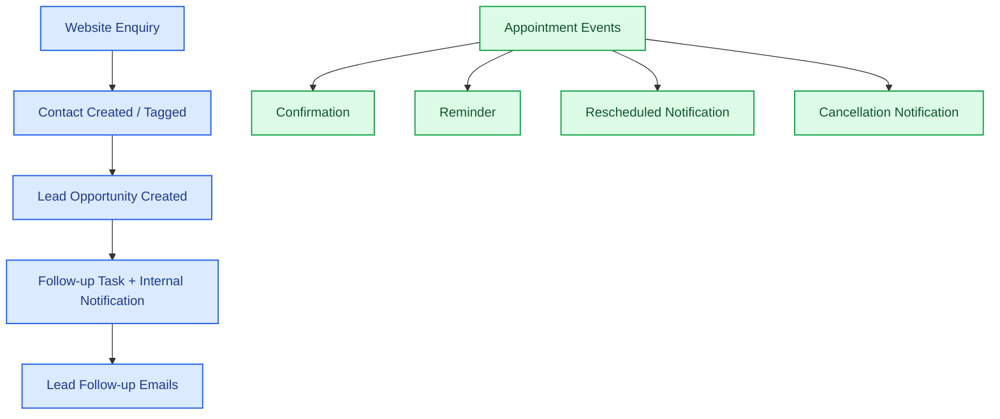

# Smile Dental CRM & Appointment Automation

**A GoHighLevel workflow automation demo for a dental clinic**

*Lead management • Appointment management • Automated follow-ups*

---

## Project Overview

Smile Dental CRM & Appointment Automation is a hands-on portfolio project built with **GoHighLevel (GHL)**. It demonstrates how a dental clinic can organize incoming enquiries, track leads, coordinate appointment events, and automate routine follow-up communications.

The project contains six published workflows covering website lead follow-up and key appointment lifecycle events.

> **Project type:** Practice / portfolio demonstration  
> **Platform:** GoHighLevel  
> **Implementation scope:** CRM workflow configuration and email/internal-notification automation  
> **Production status:** Demo only; not deployed for a real dental clinic

## Business Problem

A dental clinic may handle enquiries and appointments through disconnected manual processes. This can lead to:

- Website enquiries not being followed up consistently.
- Staff having to create lead records and reminders manually.
- Patients not receiving timely appointment communications.
- Front-desk staff having limited visibility into booking changes.
- Follow-up activity being difficult to track in one place.

## Proposed Solution

The demo uses GoHighLevel CRM and Workflows to centralize lead and appointment-related processes:

- Capture a website lead using a contact-tag trigger.
- Create an opportunity and follow-up task for the lead.
- Notify the team when a new website lead enters the workflow.
- Send lead acknowledgement and conditional follow-up emails.
- Automate appointment confirmation, reminder, rescheduling, and cancellation communications.
- Notify front-desk staff about relevant appointment events.

## Workflow Architecture

## Workflows

| # | Workflow | Purpose |
|---|---|---|
| 1 | **New Website Lead Follow-up** | Starts when the `source_website` contact tag is added; creates an opportunity and follow-up task, then sends an internal notification. |
| 2 | **Customer Follow-up (Practice)** | Starts when an opportunity is created in the configured pipeline/stage; sends an acknowledgement email, waits, checks the opportunity stage, and conditionally sends a follow-up email. |
| 3 | **Appointment Confirmation (Practice)** | Sends an appointment confirmation email and notifies the front desk after a booking event. |
| 4 | **Appointment Reminder** | Waits until one day before the appointment and sends a reminder email. |
| 5 | **Appointment Rescheduled** | Checks whether the appointment was rescheduled; the matching branch sends an internal notification and a confirmation email. |
| 6 | **Appointment Cancellation** | Sends a cancellation email and notifies the front desk when an appointment is cancelled. |

## Workflow Screenshots

The screenshots below show the configured workflow structures. They are implementation evidence for this portfolio demo, not proof of a live production deployment.

### Workflow Overview

### 1. Appointment Confirmation

### 2. Appointment Reminder

### 3. Appointment Rescheduled

### 4. Appointment Cancellation

### 5. Customer Follow-up

### 6. New Website Lead Follow-up

## Technology Stack

| Technology | Usage |
|---|---|
| [GoHighLevel](https://www.gohighlevel.com/) | CRM, contact and opportunity management, calendars, workflow automation |
| GoHighLevel Workflows | Triggers, conditions, waits, email actions, and internal notifications |
| Email actions | Lead acknowledgement and appointment-related communications |
| Internal Notifications | Front-desk and team alerts |

## Testing & Validation

The following reflects the testing performed during the demo build. Workflow publication and successful action execution do not, by themselves, guarantee inbox delivery or production readiness.

| Workflow | Validation performed | Status / notes |
|---|---|---|
| Appointment Confirmation | Test booking; confirmation email content checked for appointment title, date, and time; front-desk notification action configured. | Tested; email content rendered as expected. |
| Appointment Rescheduled | Tested a rescheduled appointment and a normal booking; checked the matching and non-matching branches and execution logs. | Both branch paths behaved as expected in the test. |
| Appointment Cancellation | Tested cancellation; checked patient email and workflow execution log. | Cancellation email received; notification action executed. |
| Appointment Reminder | Configured a one-day-before wait and reminder email action. | Published; end-to-end reminder delivery and time merge-field accuracy still require verification. |
| Customer Follow-up | Tested acknowledgement and follow-up actions using a temporary one-minute wait, then restored the intended one-day wait. | Actions executed and were queued/accepted; inbox receipt was not confirmed. |
| New Website Lead Follow-up | Published workflow with tag trigger, opportunity creation, task creation, and internal notification. | Published; detailed end-to-end execution verification remains outstanding. |

### Workflow Enrollment Snapshot

At the time the workflow overview screenshot was captured, the GHL list showed the following counts:

| Workflow | Total enrolled | Active enrolled |
|---|---:|---:|
| Appointment Cancellation | 1 | 0 |
| Appointment Confirmation (Practice) | 7 | 0 |
| Appointment Reminder | 1 | 1 |
| Appointment Rescheduled | 15 | 0 |
| Customer Follow-up (Practice) | 2 | 1 |
| New Website Lead Follow-up | 5 | 0 |

These are point-in-time demo counts, not performance metrics or evidence of patient outcomes. The reminder and customer follow-up workflows each showed one active enrollment at that time.

## Project Outcomes

- Configured six GoHighLevel workflows for lead and appointment processes.
- Demonstrated opportunity creation, task creation, conditional branching, wait steps, email actions, and internal notifications.
- Tested key appointment confirmation, rescheduling, and cancellation paths.
- Documented workflow structures and validation gaps for future improvement.

## Future Enhancements

1. **Dedicated clinic calendar:** Create and configure a dedicated clinic appointment calendar, including staff assignment, availability, business hours, and time zone.
2. **Email deliverability:** Configure a verified sending domain and validate sender authentication and inbox delivery.
3. **Appointment data validation:** Confirm all appointment date/time merge fields against real test bookings.
4. **SMS / WhatsApp reminders:** Add consent-based messaging with opt-out handling and delivery-failure handling.
5. **Lead ownership:** Add assignment rules, lead routing, and overdue follow-up alerts.
6. **Review automation:** Send post-visit review requests with appropriate timing and consent.
7. **Reporting dashboard:** Track enquiry volume, appointment bookings, cancellations, reschedules, and follow-up completion.
8. **Reliability controls:** Add duplicate-event handling, retry/error paths, workflow monitoring, and documented recovery procedures.

## Production Readiness & Security Notes

This is a demonstration project. Before adapting it for a real clinic:

- Create and test a dedicated clinic calendar; this demo used an existing GoHighLevel personal calendar as the appointment trigger filter. No dedicated clinic calendar was created.
- Replace demo staff, calendar, pipeline, and contact details with approved clinic configuration.
- Verify email sender authentication, delivery, and every appointment merge field.
- Obtain appropriate consent before sending SMS or WhatsApp messages and support opt-out requests.
- Apply least-privilege access to staff accounts and protect patient/contact information.
- Never commit API keys, access tokens, passwords, patient data, medical records, or private account identifiers.
- Review screenshots for personal names, calendar labels, account identifiers, and other information that should not be public.
- Test duplicate bookings, reschedules, cancellations, failed actions, and workflow re-entry before production use.

## Setup Overview

This repository documents the workflow design and screenshots. It does **not** contain an importable GoHighLevel workflow export or credentials.

To recreate the demo in a GoHighLevel test location:

1. Configure a test pipeline and the required opportunity stages.
2. Configure a test contact tag such as `source_website`.
3. Configure a test calendar and appointment event settings.
4. Create the six workflows described above.
5. Configure test email actions and internal notifications.
6. Run controlled test cases and inspect Enrollment History and Execution Logs.
7. Replace demo configuration with clinic-approved settings only after validation.

## Author

**Aminul Islam**  
Software Developer | Oracle APEX & Database Development | CRM and AI Workflow Automation

- **GitHub:** [Aminul-Eng](https://github.com/Aminul-Eng)
- **Portfolio:** [aminulaicloud.com](https://aminulaicloud.com)
- **Project repository:** [smile-dental-crm-automation](https://github.com/Aminul-Eng/smile-dental-crm-automation)

This project was designed and documented by Aminul Islam as a practical portfolio demonstration of CRM workflow configuration, business process automation, and appointment lifecycle handling using GoHighLevel.

## Disclaimer

This project is an independent practice/portfolio demonstration. It is not an official GoHighLevel product, is not affiliated with or endorsed by GoHighLevel, and is not a live clinical system. “Smile Dental” is a fictional demo business name. Do not use this demo as-is to process real patient information.
