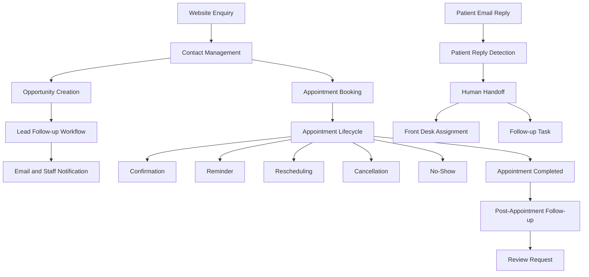

# Smile Dental CRM & Appointment Automation

<div align="center">

<a href="https://www.gohighlevel.com/" target="_blank">
  
</a>

**Powered by GoHighLevel**

A CRM, Lead Management, Appointment Automation and Patient Communication Portfolio Project.

[](https://www.gohighlevel.com/)
[]()
[]()
[]()

**Lead Management • Appointment Automation • Patient Communication • CRM Workflows**

</div>

---

## 1. Project Overview

Smile Dental CRM & Appointment Automation is a hands-on portfolio project built using **GoHighLevel (GHL)**.

The project demonstrates how a dental clinic can manage website enquiries, organize leads, automate appointment communications, handle patient replies, manage cancellations and no-shows, and coordinate front-desk follow-up activities.

The system includes 11 configured workflows covering the lead management and appointment lifecycle.

| Project Information | Details |
|---|---|
| Project Name | Smile Dental CRM & Appointment Automation |
| Platform | GoHighLevel |
| Project Type | Practice / Portfolio Demonstration |
| Business Type | Fictional Dental Clinic |
| Automation | GHL Workflows |
| Communication | Email and Internal Notifications |
| Calendar | Emily Front Desk's Personal Calendar |
| Workflow Count | 11 |
| Production Status | Demo Only |

> This is an independent portfolio demonstration. It is not a live clinical system and does not process real patient information.

## 2. Business Requirements

The demo addresses common operational challenges in dental clinic management:

- Website enquiries requiring timely follow-up.
- Manual lead and opportunity management.
- Appointment confirmation and reminder communication.
- Appointment rescheduling and cancellation handling.
- Patient replies requiring staff attention.
- Missed appointments requiring follow-up.
- Post-appointment communication.
- Patient review requests.
- Double-booking prevention.

## 3. Proposed Solution

The project uses GoHighLevel CRM and Workflows to automate key business processes.

Main capabilities:

- Website lead capture using contact tags.
- Automatic opportunity creation and task assignment.
- Lead acknowledgement and conditional follow-up emails.
- Appointment confirmation and reminder emails.
- Appointment rescheduling and cancellation handling.
- Patient reply detection and human handoff.
- No-show follow-up automation.
- Post-appointment thank-you communication.
- Automated review request emails.
- Front-desk notifications and follow-up tasks.

## 4. System Architecture



## 5. Workflow Inventory

The project contains 11 workflows.

| # | Workflow | Purpose |
|---|---|---|
| 1 | New Website Lead Follow-up | Creates an opportunity and follow-up task when the website source tag is added. |
| 2 | Customer Follow-up | Sends acknowledgement and conditional follow-up emails based on opportunity stage. |
| 3 | Appointment Confirmation | Sends booking confirmation email and front-desk notification. |
| 4 | Appointment Reminder | Sends an appointment reminder one day before the scheduled appointment. |
| 5 | Appointment Rescheduled | Detects rescheduling and sends confirmation and staff notification. |
| 6 | Appointment Cancellation | Sends cancellation email and front-desk notification. |
| 7 | Patient Reply & Human Handoff | Detects email/SMS replies and assigns follow-up to the front desk. |
| 8 | No-Show Automation | Sends rescheduling email, creates a task, applies a tag, and notifies staff. |
| 9 | Post-Appointment Follow-up | Sends a thank-you email and creates a follow-up task. |
| 10 | Review Request Automation | Waits one day after appointment completion and sends a review request email. |
| 11 | Rescheduled Appointment Reminder | Uses an appointment-status trigger and rescheduled condition to schedule a reminder before the updated appointment. |

### Workflow Details

#### 1. New Website Lead Follow-up

Trigger: Contact Tag Added (`source_website`).

Actions:
- Create Opportunity.
- Create Follow-up Task.
- Notify Front Desk.

#### 2. Customer Follow-up

Trigger: Opportunity Created.

Actions:
- Send acknowledgement email.
- Wait one day.
- Check opportunity stage.
- Send conditional follow-up email.

#### 3. Appointment Confirmation

Trigger: Customer Booked Appointment.

Actions:
- Send confirmation email.
- Notify front-desk staff.

#### 4. Appointment Reminder

Trigger: Customer Booked Appointment.

Actions:
- Wait until one day before the appointment.
- Send appointment reminder email.

#### 5. Appointment Rescheduled

Trigger: Appointment Status.

Condition:
- `Rescheduled = True`

Actions:
- Send rescheduling confirmation email.
- Notify Front Desk.

#### 6. Appointment Cancellation

Trigger: Appointment Status — Cancelled.

Actions:
- Send cancellation email.
- Notify Front Desk.

#### 7. Patient Reply & Human Handoff

Triggers:
- Customer Replied — Email.
- Customer Replied — SMS.

Actions:
- Apply `Needs Human Follow-up` tag.
- Assign conversation to Front Desk.
- Create patient follow-up task.
- Notify Front Desk.

Email reply execution was tested successfully. SMS execution requires a configured phone number and messaging service.

#### 8. No-Show Automation

Trigger: Appointment Status — No-show.

Actions:
- Apply Appointment No-Show tag.
- Send rescheduling email.
- Notify Front Desk.
- Create No-Show Follow-up Task.

#### 9. Post-Appointment Follow-up

Trigger: Appointment Completed.

Actions:
- Send post-appointment thank-you email.
- Create post-appointment follow-up task.

#### 10. Review Request Automation

Trigger: Appointment Completed.

Actions:
- Wait one day.
- Send patient review request email.

#### 11. Rescheduled Appointment Reminder

Trigger: Appointment Status.

Condition:
- `Rescheduled = True`

Actions:
- Wait until one day before the updated appointment.
- Send rescheduled appointment reminder email.

The rescheduled branch was tested, and the contact entered the scheduled wait step.

## 6. Technology Stack

| Technology | Purpose |
|---|---|
| GoHighLevel CRM | Contact, opportunity and calendar management |
| GoHighLevel Workflows | Business process automation |
| Email Actions | Patient and lead communication |
| Internal Notifications | Front-desk alerts |
| GHL Calendar | Appointment scheduling |
| Conditional Branching | Workflow decision logic |
| Wait Actions | Time-based automation |

## 7. Testing & Validation

The following table summarizes the tests performed during the demo implementation.

| Workflow / Feature | Validation | Result |
|---|---|---|
| Appointment Confirmation | Test booking and confirmation email | Tested |
| Appointment Rescheduled | True and false branch execution | Passed |
| Appointment Cancellation | Cancellation email and notification actions | Passed |
| Appointment Reminder | One-day-before wait configuration | Configured; delivery verification pending |
| Customer Follow-up | Temporary one-minute wait test; restored one-day wait | Actions executed; inbox receipt not confirmed |
| New Website Lead Follow-up | Tag, opportunity, task and notification configuration | Published; detailed end-to-end validation pending |
| Patient Reply & Human Handoff | Email reply, tag, assignment, task and notification | Passed |
| No-Show Automation | Tag, email action, task and notification | Passed |
| Post-Appointment Follow-up | Thank-you email action and task creation | Passed |
| Review Request Automation | One-day wait and test email receipt | Passed |
| Rescheduled Appointment Reminder | Rescheduled condition and scheduled wait | Passed |
| Double Booking Test | Same calendar and same time slot with two contacts | Passed in the tested scenario |

### Double Booking Test

**Test Objective:** Verify whether the same calendar allows two appointments for the same time slot.

Test configuration:

| Parameter | Value |
|---|---|
| Calendar | Emily Front Desk's Personal Calendar |
| Date | November 9, 2026 |
| Time Slot | 11:00 AM – 11:30 AM CST |
| Contact A | Double Booking A |
| Contact B | Double Booking B |

Test results:

1. Contact A successfully booked the selected slot.
2. Contact B was selected for the same date and calendar.
3. The 11:00 AM – 11:30 AM slot was not available in the second booking form.
4. A later slot was displayed instead.

**Result:** The tested calendar prevented the second booking for the same time slot.

> This is a successful functional test of the tested scenario, not a guarantee against every possible concurrent-booking race condition.

### Important Testing Notes

- An `Executed` workflow action indicates that GHL executed the action; it does not independently prove inbox delivery.
- Email receipt was confirmed for the Review Request test and the Patient Reply test was validated through execution logs.
- SMS was not fully tested because no phone number was configured for messaging.
- The appointment reminder's actual delivery and all appointment date/time merge fields still require further verification.
- The project uses synthetic test contacts.

## 8. Project Screenshots

Screenshots should be stored in the repository under the `screenshots/` directory.

Suggested structure:

```text
screenshots/
├── workflows/
│   ├── 00-workflow-overview.png
│   ├── 01-appointment-confirmation.png
│   ├── 02-appointment-reminder.png
│   ├── 03-appointment-rescheduled.png
│   ├── 04-appointment-cancellation.png
│   ├── 05-customer-follow-up.png
│   ├── 06-new-website-lead-follow-up.png
│   ├── 07-patient-reply-human-handoff.png
│   ├── 08-no-show-automation.png
│   ├── 09-post-appointment-follow-up.png
│   ├── 10-review-request-automation.png
│   └── 11-rescheduled-appointment-reminder.png
│
└── testing/
    ├── 01-patient-reply-execution.png
    ├── 02-no-show-execution.png
    ├── 03-post-appointment-execution.png
    ├── 04-review-request-email.png
    ├── 05-rescheduled-reminder-execution.png
    └── 06-double-booking-test.png
```

Add screenshots only after saving the corresponding evidence files to the repository.

## 9. Project Outcomes

This project demonstrates practical experience with:

- CRM contact and opportunity management.
- Multi-step workflow configuration.
- Appointment lifecycle automation.
- Conditional branching and time-based waits.
- Email communication automation.
- Internal notifications and task creation.
- Human handoff and staff assignment.
- No-show and review-request automation.
- Calendar availability validation.
- Workflow execution-log analysis.

## 10. Production Readiness & Security

This is a portfolio demonstration, not a production clinical application.

Before adapting the system for a real dental clinic:

- Configure a dedicated clinic calendar and approved staff schedules.
- Configure a verified email sending domain.
- Validate all appointment merge fields and actual email delivery.
- Configure an approved SMS provider and consent-based messaging.
- Implement opt-out handling.
- Use role-based access and least-privilege permissions.
- Protect patient and contact information.
- Avoid including sensitive health information in general-purpose automation messages.
- Implement duplicate-event handling, retries and monitoring.
- Test appointment conflicts, reschedules, cancellations and workflow re-entry.
- Review applicable privacy, security and healthcare compliance requirements.

**No HIPAA compliance or production deployment is claimed for this demo.**

## 11. Future Enhancements

1. Dedicated clinic calendar configuration.
2. Verified email domain and deliverability monitoring.
3. SMS and WhatsApp integration with consent and opt-out handling.
4. Advanced appointment conflict and concurrency testing.
5. Workflow error handling and recovery procedures.
6. Lead assignment and overdue follow-up alerts.
7. Reporting dashboard for leads and appointment performance.
8. Automated suppression of outdated reminders after appointment changes.
9. More comprehensive integration and regression testing.

## 12. Setup Overview

This repository documents workflow design, implementation and testing evidence. It does not contain importable GoHighLevel workflow exports or account credentials.

To recreate the demo:

1. Configure a GoHighLevel test location.
2. Create a test pipeline and opportunity stages.
3. Configure the required contact tags.
4. Configure a test calendar and team member.
5. Create the workflows described in this README.
6. Configure email actions and internal notifications.
7. Run test cases using synthetic contacts.
8. Inspect Enrollment History and Execution Logs.
9. Document the results and screenshots.

## 13. Author

**Aminul Islam**

Software Developer | Oracle APEX & Database Development | CRM and AI Workflow Automation

- **GitHub:** [Aminul-Eng](https://github.com/Aminul-Eng)
- **Portfolio:** [aminulaicloud.com](https://aminulaicloud.com)
- **Project Repository:** [smile-dental-crm-automation](https://github.com/Aminul-Eng/smile-dental-crm-automation)

## 14. Platform Branding

This project uses the GoHighLevel platform for demonstration purposes. HighLevel and its logo are trademarks of their respective owner. This independent portfolio project is not sponsored, endorsed or certified by HighLevel.

## 15. Disclaimer

This project is an independent practice and portfolio demonstration. It is not an official GoHighLevel product, is not affiliated with or endorsed by GoHighLevel, and is not a live clinical system.

“Smile Dental” is a fictional demo business name. Do not use this demonstration as-is to process real patient information.

---

<div align="center">

**Built as a practical demonstration of CRM, appointment and business process automation using GoHighLevel.**

</div>
